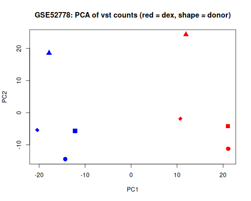
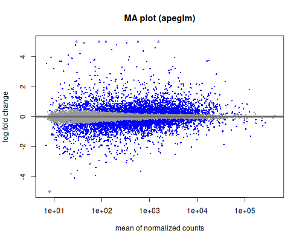
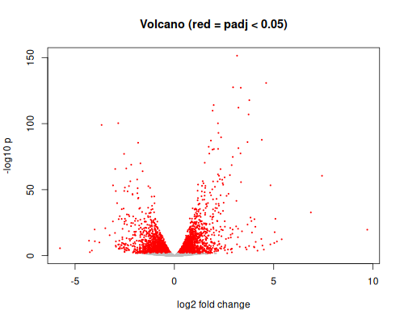

<div dir="rtl">

# درس: بیان افتراقی با DESeq2؛ از جدول شمارش به ژن‌های تغییرکرده

**بخش:** `13_V2_RNAseq_Transcriptomics` · **ماژول:** `03_Differential_Expression` · **پیش‌نیاز:** ماژول [13/02](../02_Alignment_Quantification/) (`gene_counts_salmon.tsv`)؛ GSE52778 ([11/04](../../11_V2_NCBI_Databases/04_GEO/))؛ Expression Atlas ([12/06](../../12_V2_Global_Databases_Browsers/06_Expression_Cancer_Portals/))؛ اجرای `Rscript` ([04](../../04_R_Packages/)) · **زمان:** حدود ۹۰ دقیقه · **ابزار:** R 4.5.3، DESeq2 1.50.2، apeglm 1.32.0، edgeR 4.10.7، limma 3.68.5 (محیط `rnaseq`) · **آخرین بازبینی:** 2026-10-28

> ✅ **وضعیت: اجرا شده.** همه‌ی خروجی‌ها واقعی‌اند (2026-10-28). داده‌ی شبیه‌سازی‌شده ۶ ثانیه؛ GSE52778 ‏۱۹ ثانیه و نزدیک به **۱ گیگابایت** حافظه (تنها بارگذاری DESeq2 ‏۵۹۰ مگابایت است)؛ edgeR و limma ‏۳ ثانیه و ۱۸۰ مگابایت.

---

## در یک نگاه

**در پایان این درس می‌توانید:**
1. بگویید DESeq2 چگونه **هم‌سان‌سازی** می‌کند (median-of-ratios) و این روش چه فرضی دارد.
2. **فرمول طراحی** بنویسید (`~ cell + dex`) و ببینید آوردن «فرد» چقدر توان آماری را بالا می‌برد.
3. ‏**log2 fold change**، **p-value** و **padj (FDR)** را درست بخوانید و **shrinkage** (apeglm) را بفهمید.
4. ‏PCA، نمودار MA و volcano بسازید و بخوانید.
5. نتیجه را با پاسخ معلوم، با edgeR و limma-voom و با Expression Atlas بسنجید.

**پیش از آغاز:**

<div dir="ltr">

```bash
conda activate rnaseq && cd ~/rnaseq
P=~/course-bioinformatics-main/13_V2_RNAseq_Transcriptomics/99_scripts_data
bash $P/03_Differential_Expression/data/download.sh ~/rnaseq/gse      # GSE52778, about 9 MB
```

</div>

---

## ۱. داستان

در 11/04 با CPM و log2FC ساده دیدید هشت ژن با دگزامتازون جابه‌جا می‌شوند. ولی «ساده» یعنی بی **آمار**: با چهار فرد، کدام تغییر واقعی است و کدام تصادفی؟ در 13/02 جدول شمارش داده‌ی شبیه‌سازی‌شده را ساختید. این درس دو کار می‌کند:
- **بخش A (پاسخ معلوم):** ‏DESeq2 روی ۲۰ ژن شبیه‌سازی‌شده؛ می‌دانیم کدام هشت ژن تغییر کرده‌اند.
- **بخش B (داده‌ی واقعی):** ‏DESeq2 روی همه‌ی ژن‌های GSE52778؛ با مقاله‌ی Himes (CRISPLD2) و بازتحلیل Expression Atlas می‌سنجیم.

---

## ۲. مفهوم به زبان ساده

### ۲.۱ چرا آزمون t ساده بس نیست؟

- شمارش‌ها **عدد صحیح**‌اند و پراکندگی‌شان با میانگین بالا می‌رود (ژن پربیان نویز مطلق بیشتری دارد).
- با ۳ یا ۴ تکرار، برآورد پراکندگی هر ژن به تنهایی بسیار نامطمئن است.
- هزاران ژن را با هم می‌آزماییم: با p < ۰٫۰۵، از ۱۷ هزار ژن بی‌تغییر، نزدیک به ۸۵۰ ژن تصادفی «معنادار» می‌شوند.

### ‏۲.۲ ‏DESeq2 در چهار گام

1. **هم‌سان‌سازی (size factor):** برای هر ژن، نسبت شمار هر نمونه به میانگین هندسی همه‌ی نمونه‌ها گرفته می‌شود؛ **میانه**ی این نسبت‌ها ضریب اندازه‌ی آن نمونه است. **فرض:** بیشترِ ژن‌ها تغییر نکرده‌اند.
2. **پراکندگی (dispersion):** برای هر ژن برآورد، و به سوی روند عمومی ژن‌های هم‌اندازه «کشیده» می‌شود. ژن‌ها از هم «قرض» می‌گیرند تا برآورد با تکرار کم پایدار شود.
3. **مدل دوجمله‌ای منفی** با فرمول طراحی، و آزمون Wald برای ضریب مورد نظر (log2 fold change).
4. **تصحیح آزمون‌های بسیار** با روش Benjamini–Hochberg: ‏`padj` = ‏**FDR**. ‏`padj < 0.05` یعنی «از ژن‌هایی که برگزیدیم، انتظار داریم نزدیک به ۵٪ نادرست باشند».

### ۲.۳ فرمول طراحی

‏`~ cell + dex` یعنی: «بیان هر ژن = اثر فرد + اثر دگزامتازون». آزمون روی `dex` است، ولی چون `cell` در مدل هست، تفاوت پایه‌ی افراد از نویز بیرون می‌رود. **آخرین** متغیر فرمول همان است که در بسیاری از موارد می‌آزماییم. سطح مرجع (`untrt`) را با `relevel` روشن کنید تا log2FC «دگزامتازون نسبت به بی‌تیمار» باشد، نه وارونه.

### ‏۲.۴ shrinkage

ژنی با ۳ رید در شاهد و ۳۰ رید در تیمار log2FC ‏۳٫۳ دارد، ولی بسیار نامطمئن. **apeglm** چنین log2FCهایی را به سوی صفر می‌کشد، به اندازه‌ی ناامنی‌شان. ژن‌های پربیان کمابیش دست‌نخورده می‌مانند. برای **رتبه‌بندی** و **نمودار** log2FC کوچک‌شده بهتر است؛ آزمون و padj همان می‌مانند.

---

## ۳. بخش A: پاسخ معلوم

<div dir="ltr">

```bash
Rscript $P/03_Differential_Expression/scripts/de_simulated.R gene_counts_salmon.tsv reads/truth_counts.tsv
```

</div>

هسته‌ی اسکریپت:

<div dir="ltr">

```r
coldata <- data.frame(condition = factor(c("ctrl", "ctrl", "ctrl", "dex", "dex", "dex"), levels = c("ctrl", "dex")),
                      row.names = colnames(counts))
dds <- DESeqDataSetFromMatrix(counts, coldata, design = ~ condition)
dds <- DESeq(dds, quiet = TRUE)
res <- results(dds, contrast = c("condition", "dex", "ctrl"), alpha = 0.05)
shr <- lfcShrink(dds, coef = "condition_dex_vs_ctrl", type = "apeglm", quiet = TRUE)
```

</div>

| بخش | کار |
| :--- | :--- |
| ‏`DESeqDataSetFromMatrix` | جدول شمارش (عدد صحیح!) + جدول نمونه‌ها + فرمول |
| ‏`DESeq()` | هر سه گام: size factor، پراکندگی، مدل و آزمون |
| ‏`contrast = c("condition", "dex", "ctrl")` | ‏log2FC = ‏dex نسبت به ctrl |
| ‏`alpha = 0.05` | آستانه‌ی FDR برای خلاصه و فیلتر مستقل |
| ‏`lfcShrink(…, type = "apeglm")` | ‏log2FC کوچک‌شده |

**خروجی واقعی (2026-10-28؛ ۶ ثانیه):**

<div dir="ltr">

```
size factors:
ctrl_1 ctrl_2 ctrl_3  dex_1  dex_2  dex_3 
 0.776  1.006  0.951  1.117  1.206  1.086 
         true_lfc baseMean   lfc lfc_shrunk     padj
FKBP5         3.3      565  2.81       2.75 1.48e-15
ZBTB16        5.1      151  4.06       3.94 4.74e-14
TSC22D3       2.8      286  2.70       2.59 7.76e-10
PER1          3.0      286  2.83       2.71 2.42e-09
NR3C1        -1.0     2131 -1.59      -1.53 7.46e-08
DUSP1         2.8      537  2.15       2.02 6.07e-06
CRISPLD2      2.4      842  1.94       1.80 5.51e-05
KLF15         3.4       65  3.22       2.90 6.89e-05
TUBB          0.0     3877 -0.49      -0.46 7.31e-02
YWHAZ         0.0     3959 -0.46      -0.44 1.00e-01
RPLP0         0.0     3394 -0.44      -0.42 1.53e-01
PGK1          0.0     2804 -0.47      -0.43 2.06e-01
ACTB          0.0     9655 -0.33      -0.32 2.47e-01
EEF1A1        0.0    49857 -0.34      -0.33 2.47e-01
PPIA          0.0     1159 -0.30      -0.28 4.00e-01
TBP           0.0       38 -0.78      -0.47 4.58e-01
SDHA          0.0      482 -0.18      -0.16 6.79e-01
HPRT1         0.0       32 -0.42      -0.23 6.81e-01
B2M           0.0     2388 -0.11      -0.10 6.81e-01
GAPDH         0.0     5147 -0.07      -0.07 7.66e-01

called DE (padj < 0.05): 8  true positives: 8  false positives: 0  missed: 0 
```

</div>

**توضیح خروجی:**
- **هشت از هشت** ژن تغییرکرده یافت شدند و **هیچ** ژن بی‌تغییری «معنادار» نشد. ✅
- ولی log2FC ژن‌های بی‌تغییر **صفر نیست**: همه کمی منفی‌اند (‏−۰٫۱ تا −۰٫۵)، و NR3C1 ‏−۱٫۵۹ به جای −۱. چرا؟ فرض گام ۱ (بیشتر ژن‌ها بی‌تغییر) این‌جا **شکسته است**: ۸ از ۲۰ ژن تغییر کرده‌اند و هفت تا به‌شدت بالا رفته‌اند. ضریب اندازه‌ی نمونه‌های dex کمی بزرگ‌تر از باید برآورد شد و همه‌ی ژن‌ها کمی پایین دیده شدند. در داده‌ی واقعی با هزاران ژن (بخش B) این اثر بسیار کوچک‌تر است.
- ‏**shrinkage:** برای ژن‌های پربیان (GAPDH ‏−۰٫۰۷ ← −۰٫۰۷) کمابیش بی‌اثر است؛ برای کم‌بیان‌ها (TBP ‏−۰٫۷۸ ← −۰٫۴۷؛ KLF15 ‏۳٫۲۲ ← ۲٫۹۰) بیشتر.

<details>
<summary>✋ امتحان کن: اگر ۱۹ ژن از ۲۰ بالا رفته بودند، median-of-ratios چه می‌کرد؟</summary>

میانه‌ی نسبت‌ها از ژن‌های **بالارفته** می‌آمد. ضریب اندازه‌ی نمونه‌های تیمار بسیار بزرگ برآورد می‌شد و پس از هم‌سان‌سازی بیشتر ژن‌ها «بی‌تغییر» و یک ژن بی‌تغییر «پایین‌رفته» دیده می‌شد. برای آزمایش‌هایی که بیان کلی را عوض می‌کنند (مانند مهار کلی رونویسی) به **spike-in**‌ها (11/04) یا هم‌سان‌سازی ویژه نیاز است.

</details>

> 📺 **فیلم:** *StatQuest: DESeq2, part 1, Library Normalization*: https://www.youtube.com/watch?v=UFB993xufUU · *False Discovery Rates, FDR, clearly explained* (StatQuest): https://www.youtube.com/watch?v=K8LQSvtjcEo
> 📄 **مرجع:** Love MI, Huber W, Anders S (2014). *Moderated estimation of fold change and dispersion for RNA-seq data with DESeq2.* Genome Biol 15:550. https://doi.org/10.1186/s13059-014-0550-8 · Zhu A, Ibrahim JG, Love MI (2019). *Heavy-tailed prior distributions for sequence count data* (apeglm). Bioinformatics 35:2084–2092. https://doi.org/10.1093/bioinformatics/bty895

---

## ۴. بخش B: داده‌ی واقعی GSE52778

<div dir="ltr">

```bash
cd ~/rnaseq/gse
Rscript $P/03_Differential_Expression/scripts/de_gse52778.R GSE52778_series_matrix.txt.gz counts.tsv.gz geneid2ens.tsv e52778.tsv
```

</div>

اسکریپت جدول نمونه‌ها را از series matrix می‌سازد (همانند `geo_counts.py` در 11/04)، تنها **بی‌تیمار** و **دگزامتازون** را نگه می‌دارد (۸ نمونه از ۴ فرد)، ژن‌هایی را که در دست‌کم ۴ نمونه ۱۰ رید یا بیشتر دارند نگه می‌دارد، و DESeq2 را با `~ cell + dex` می‌زند. هسته‌ی آن:

<div dir="ltr">

```r
cd$dex <- relevel(factor(ifelse(cd$treatment == "Dexamethasone", "dex", "untrt")), ref = "untrt")
ct <- ct[rowSums(ct >= 10) >= 4, ]
dds <- DESeqDataSetFromMatrix(ct, cd, design = ~ cell + dex)
dds <- DESeq(dds, quiet = TRUE)
res <- results(dds, name = "dex_dex_vs_untrt", alpha = 0.05)
```

</div>

### ۴.۱ خلاصه و ژن‌های برتر

**خروجی واقعی (2026-10-28؛ کوتاه‌شده):**

<div dir="ltr">

```
== samples and genes kept: 8 x 16802 

== DESeq2 ~ cell + dex

out of 16802 with nonzero total read count
adjusted p-value < 0.05
LFC > 0 (up)       : 2557, 15%
LFC < 0 (down)     : 2186, 13%
outliers [1]       : 0, 0%
low counts [2]     : 0, 0%

== top 10 by padj
         symbol baseMean log2FC log2FC_shrunk      padj
783      CACNB2      749   3.16          3.15 5.98e-148
8404    SPARCL1     1318   4.62          4.60 1.44e-127
1843      DUSP1     4469   2.95          2.94 1.86e-124
4128       MAOA     3063   3.34          3.33 3.00e-124
25939    SAMHD1    17751   3.77          3.76 6.15e-115
261729   STEAP2     4068   1.98          1.97 2.48e-111
12     SERPINA3     3465   3.23          3.21 1.90e-109
91624      NEXN     7460   1.92          1.92 3.11e-107
2878       GPX3    16078   3.74          3.72 2.07e-104
167681   PRSS35      410  -2.83         -2.81  7.87e-98

== the 8 genes of 11/04
        symbol baseMean log2FC log2FC_shrunk      padj
2908     NR3C1     3689  -0.99         -0.97  4.46e-23
2289     FKBP5     3376   4.03          3.95  2.14e-26
1831   TSC22D3     2851   3.21          3.13  2.19e-19
7704    ZBTB16     1537   7.43          7.38  1.37e-58
5187      PER1     1028   3.22          3.21  2.98e-79
1843     DUSP1     4469   2.95          2.94 1.86e-124
28999    KLF15      740   4.40          4.38  1.82e-85
83716 CRISPLD2     4020   2.63          2.60  1.05e-43
```

</div>

**توضیح خروجی:**
- از ۱۶٬۸۰۲ ژن، **۴۷۴۳** (۲۸٪) با FDR ‏۵٪ تغییر کرده‌اند: ۲۵۵۷ بالا و ۲۱۸۶ پایین. دگزامتازون پاسخی بسیار گسترده دارد.
- هر هشت ژن 11/04 بسیار معنادارند؛ **CRISPLD2** (یافته‌ی اصلی مقاله‌ی Himes) با padj ‏10⁻⁴³. ✅ ‏ZBTB16 بزرگ‌ترین تغییر را دارد (log2FC ‏۷٫۴، نزدیک به ۱۷۰ برابر)، چون در شاهد کمابیش خاموش است.
- برترین‌ها بر پایه‌ی **padj** ژن‌هایی‌اند با تغییر بزرگ **و** پوشش بالا (DUSP1، SAMHD1، GPX3). padj بسیار کوچک یعنی **اطمینان**، نه **اندازه**ی اثر.
- ‏shrinkage در این داده کم است (log2FC و log2FC کوچک‌شده نزدیک‌اند)، چون این ژن‌ها پربیان‌اند.

### ۴.۲ ارزش آوردن «فرد» در فرمول

<div dir="ltr">

```
== padj < 0.05: with donor (~ cell + dex): 4743   without donor (~ dex): 3220 
```

</div>

با همان داده، تنها با افزودن `cell`، ‏**۱۵۲۳ ژن بیشتر** (۴۷٪ بیشتر) یافت شد. تفاوت پایه‌ی چهار فرد در `~ dex` به «نویز» افزوده می‌شود و آزمون را ضعیف می‌کند؛ در `~ cell + dex` از آن بیرون می‌رود. این همان ارزش طرح **جفتی** (13/01) است.

### ‏۴.۳ ‏PCA، MA و volcano

<div dir="ltr">

```
== PCA: percent variance PC1, PC2: 44.1 26.6 
              cell   dex   PC1   PC2
GSM1275862  N61311 untrt -20.4  -5.4
GSM1275863  N61311   dex  10.7  -1.9
GSM1275866 N052611 untrt -12.2  -5.6
GSM1275867 N052611   dex  21.0  -4.2
GSM1275870 N080611 untrt -17.8  18.5
GSM1275871 N080611   dex  11.9  24.3
GSM1275874 N061011 untrt -14.3 -14.5
GSM1275875 N061011   dex  21.1 -11.2
```

</div>



- ‏**PC1 (۴۴٪)** نمونه‌های دگزامتازون (سرخ، PC1 مثبت) را از بی‌تیمار (آبی، منفی) جدا می‌کند: بزرگ‌ترین منبع گوناگونی، **تیمار** است.
- ‏**PC2 (۲۷٪)** افراد را جدا می‌کند: فرد N080611 (مثلث) در بالا. دو نمونه‌ی هر فرد روی PC2 نزدیک هم‌اند. یعنی فرد دومین منبع است؛ برای همین `cell` در فرمول است.
- ‏PCA روی **vst** (تبدیل پایدارکننده‌ی واریانس) زده می‌شود، نه شمار خام، تا ژن‌های پربیان چیره نشوند. ‏`plotPCA` تنها ۵۰۰ ژن پرواریانس را به کار می‌برد.



**نمودار MA:** محور افقی میانگین بیان (log)، محور عمودی log2FC کوچک‌شده. نقطه‌های رنگی padj < ۰٫۱ (پیش‌فرض `plotMA`). در بیان کم، log2FCها پس از shrinkage به صفر نزدیک‌اند.



‏**volcano:** ‏log2FC در برابر −log10 p. نقطه‌های سرخ padj < ۰٫۰۵. بالا و دو سو: ژن‌هایی با تغییر بزرگ و مطمئن.

> 📺 **فیلم:** *StatQuest: PCA main ideas in only 5 minutes!!!*: https://www.youtube.com/watch?v=HMOI_lkzW08
> 📄 **مرجع:** Love MI, et al. *Analyzing RNA-seq data with DESeq2* (راهنمای Bioconductor؛ همین داده با بسته‌ی airway): https://bioconductor.org/packages/release/bioc/vignettes/DESeq2/inst/doc/DESeq2.html · Benjamini Y, Hochberg Y (1995). *Controlling the false discovery rate.* J R Stat Soc B 57:289–300. https://doi.org/10.1111/j.2517-6161.1995.tb02031.x

### ۴.۴ سنجش با Expression Atlas

<div dir="ltr">

```
== vs Expression Atlas: genes matched 14855  correlation of log2FC 0.893   significant in both 2044 of ours 4458 
```

</div>

‏۱۴٬۸۵۵ ژن با شناسه‌ی Ensembl جفت شدند (از راه `geneid2ens.tsv`، 12/01). همبستگی log2FC دو تحلیل **۰٫۸۹** است. ‏Expression Atlas ‏۲۱۴۲ ژن معنادار داشت (12/06)؛ ‏**۲۰۴۴** تای آن‌ها در فهرست ما هم معنادارند. یعنی Atlas کمابیش زیرمجموعه‌ای از نتیجه‌ی ما را یافته است. فهرست ما بزرگ‌تر است، شاید چون طرح جفتی (`cell`) را به کار بردیم؛ این را از فایل‌های Atlas نمی‌توان سنجید.

---

## ۵. گام ۳: ‏edgeR و limma-voom

<div dir="ltr">

```bash
Rscript $P/03_Differential_Expression/scripts/compare_methods.R GSE52778_series_matrix.txt.gz counts.tsv.gz
```

</div>

‏edgeR (TMM + مدل دوجمله‌ای منفی با آزمون quasi-likelihood) و limma-voom (log-CPM با وزن دقت + مدل خطی) با **همان** فرمول `~ cell + dex`:

<div dir="ltr">

```r
y <- normLibSizes(DGEList(ct)); y <- estimateDisp(y, design)
qlf <- glmQLFTest(glmQLFit(y, design), coef = "dexdex")
v <- voom(y, design); fit <- eBayes(lmFit(v, design))
```

</div>

**خروجی واقعی (2026-10-28؛ ۳ ثانیه):**

<div dir="ltr">

```
genes: 16802 
FDR < 0.05   DESeq2: 4743   edgeR: 5527   limma-voom: 5602 
in all three: 4626   only DESeq2: 62   only edgeR: 69   only limma: 99 
```

</div>

‏**۴۶۲۶** ژن (۹۸٪ فهرست DESeq2) در هر سه روش معنادارند. ‏edgeR و limma کمی بیشتر می‌یابند. ژن‌های «تنها یک روش» کم‌اند و بیشترشان نزدیک مرز ۰٫۰۵. روش‌های جاافتاده بر **بیشترِ** نتیجه هم‌نظرند؛ ژن‌های مرزی را با هیچ روشی جدی نگیرید.

> 📺 **فیلم:** *StatQuest: edgeR, part 1, Library Normalization*: https://www.youtube.com/watch?v=Wdt6jdi-NQo
> 📄 **مرجع:** Robinson MD, McCarthy DJ, Smyth GK (2010). *edgeR.* Bioinformatics 26:139–140. https://doi.org/10.1093/bioinformatics/btp616 · Law CW, et al. (2014). *voom: precision weights unlock linear model analysis tools for RNA-seq read counts.* Genome Biol 15:R29. https://doi.org/10.1186/gb-2014-15-2-r29

---

## ۶. سه اشتباه رایج

1. **دادن CPM، TPM یا شمار هم‌سان‌شده به DESeq2.** ‏DESeq2 و edgeR **شمار خام** (عدد صحیح) می‌خواهند و خودشان هم‌سان می‌کنند. ‏TPM را برای نمایش بیان به کار ببرید، نه برای آزمون.
2. **فراموش کردن متغیر دسته یا فرد.** ‏`~ dex` به جای `~ cell + dex` ‏۳۲٪ ژن‌ها را از دست داد. و اگر سطح مرجع را روشن نکنید، R آن را بر پایه‌ی **الفبا** برمی‌گزیند و log2FC وارونه می‌شود.
3. ‏**padj کوچک = اثر بزرگ.** ژنی با ۱۰⁻¹⁰⁰ تنها **مطمئن** است. برای اهمیت زیستی، log2FC (کوچک‌شده) و بیان پایه را هم ببینید. و p-value خام را با padj اشتباه نگیرید.

---

## 📘 برای کنجکاوها

- ‏**‏independent filtering:** DESeq2 ژن‌های بسیار کم‌بیان را پیش از تصحیح FDR کنار می‌گذارد (`padj = NA`) تا توان آماری بقیه بالا رود. این‌جا فیلتر دستی ما (≥۱۰ رید در ≥۴ نمونه) پیش‌تر همان کار را کرده بود («low counts: 0»).
- ‏**‏LRT:** برای پرسش «آیا تیمار (با چند سطح) **هیچ** اثری دارد؟» به جای Wald، آزمون نسبت درست‌نمایی (`test = "LRT", reduced = ~ cell`).
- **کم‌کردن آستانه‌ی اندازه:** ‏`results(dds, lfcThreshold = 1)` می‌آزماید که |log2FC| **بیش از** ۱ است، نه تنها بیش از صفر؛ بهتر از برش log2FC پس از آزمون.

---

## جمع‌بندی

- ‏DESeq2: هم‌سان‌سازی median-of-ratios (فرض: بیشتر ژن‌ها بی‌تغییر)، پراکندگی قرض‌گرفته، مدل دوجمله‌ای منفی، FDR.
- پاسخ معلوم: ‏۸ از ۸، بی مثبت کاذب؛ ولی با ۸ از ۲۰ ژن تغییرکرده، log2FCها کمی جابه‌جا شدند.
- ‏GSE52778: ‏۴۷۴۳ ژن (FDR ۵٪)؛ هر هشت ژن 11/04 و CRISPLD2 معنادار. ‏`~ cell + dex` ‏۴۷٪ ژن بیشتر از `~ dex`. ‏PCA: ‏PC1 تیمار (۴۴٪)، PC2 فرد (۲۷٪).
- ‏DESeq2، edgeR و limma-voom: ‏۴۶۲۶ ژن مشترک. ‏Expression Atlas: همبستگی ۰٫۸۹.
- خروجی: `de_dex_deseq2.tsv` (ورودی بخش ۱۴، غنی‌سازی).

---

## کارت دستورهای این درس

<div dir="ltr">

```r
dds <- DESeqDataSetFromMatrix(counts, coldata, design = ~ cell + dex)   # raw integer counts
dds$dex <- relevel(dds$dex, ref = "untrt")                               # reference level
dds <- DESeq(dds)
res <- results(dds, name = "dex_dex_vs_untrt", alpha = 0.05); summary(res)
shr <- lfcShrink(dds, coef = "dex_dex_vs_untrt", type = "apeglm")
vsd <- vst(dds); plotPCA(vsd, intgroup = c("cell", "dex"))
plotMA(shr)
# edgeR: DGEList -> normLibSizes -> estimateDisp -> glmQLFit -> glmQLFTest
# limma: voom -> lmFit -> eBayes -> topTable
```

</div>

---

## واژه‌نامه‌ی درس

| واژه | معنا |
| :--- | :--- |
| بیان افتراقی | تفاوت معنادار بیان یک ژن میان دو گروه |
| ضریب اندازه (size factor) | ضریب هم‌سان‌سازی هر نمونه در DESeq2 |
| ‏median-of-ratios | روش هم‌سان‌سازی DESeq2؛ میانه‌ی نسبت به میانگین هندسی |
| پراکندگی (dispersion) | اندازه‌ی گوناگونی زیستی، بیش از پواسون |
| فرمول طراحی | متغیرهای مدل؛ برای نمونه `~ cell + dex` |
| سطح مرجع | گروهی که دیگران نسبت به آن سنجیده می‌شوند |
| ‏padj / FDR | ‏p-value تصحیح‌شده؛ نسبت انتظاری یافته‌های نادرست |
| ‏shrinkage (apeglm) | کشیدن log2FCهای نامطمئن به سوی صفر |
| ‏vst | تبدیلی که واریانس را در همه‌ی سطح‌های بیان یکسان می‌کند؛ برای PCA و نقشه‌ی گرمایی |
| ‏MA / volcano | نمودار log2FC در برابر بیان / در برابر −log10 p |
| ‏TMM | روش هم‌سان‌سازی edgeR |
| ‏voom | تبدیل شمارش به log-CPM با وزن دقت برای limma |

---

## منابع

**مقاله و مستند**
- ‏Love MI, Huber W, Anders S (2014). *Moderated estimation of fold change and dispersion for RNA-seq data with DESeq2.* Genome Biol 15:550. https://doi.org/10.1186/s13059-014-0550-8
- ‏Anders S, Huber W (2010). *Differential expression analysis for sequence count data.* Genome Biol 11:R106. https://doi.org/10.1186/gb-2010-11-10-r106
- ‏Zhu A, Ibrahim JG, Love MI (2019). *Heavy-tailed prior distributions for sequence count data: removing the noise and preserving large differences.* Bioinformatics 35:2084–2092. https://doi.org/10.1093/bioinformatics/bty895
- ‏Robinson MD, McCarthy DJ, Smyth GK (2010). *edgeR: a Bioconductor package for differential expression analysis of digital gene expression data.* Bioinformatics 26:139–140. https://doi.org/10.1093/bioinformatics/btp616
- ‏Law CW, Chen Y, Shi W, Smyth GK (2014). *voom: precision weights unlock linear model analysis tools for RNA-seq read counts.* Genome Biol 15:R29. https://doi.org/10.1186/gb-2014-15-2-r29
- ‏Benjamini Y, Hochberg Y (1995). *Controlling the false discovery rate: a practical and powerful approach to multiple testing.* J R Stat Soc B 57:289–300. https://doi.org/10.1111/j.2517-6161.1995.tb02031.x
- ‏Himes BE, et al. (2014). PLoS ONE 9:e99625. https://doi.org/10.1371/journal.pone.0099625

**کتاب**
- ‏Holmes S, Huber W (2019). *Modern Statistics for Modern Biology.* Cambridge University Press. دسترسی آزاد: https://www.huber.embl.de/msmb/ (فصل ۸: داده‌ی شمارشی با DESeq2)
- ‏Korpelainen E, et al. (2014). *RNA-seq Data Analysis: A Practical Approach.* CRC Press.

**فیلم و دوره‌ی آموزشی**
- ‏Coursera: *Bioconductor for Genomic Data Science* (Johns Hopkins): https://www.coursera.org/learn/bioconductor
- ‏edX: *Introduction to Genomic Data Science* (UC San Diego): https://www.edx.org/learn/bioinformatics/the-university-of-california-san-diego-introduction-to-genomic-data-science
- ‏YouTube: *StatQuest: DESeq2, part 1, Library Normalization*: https://www.youtube.com/watch?v=UFB993xufUU
- ‏YouTube: *False Discovery Rates, FDR, clearly explained* (StatQuest): https://www.youtube.com/watch?v=K8LQSvtjcEo
- ‏YouTube: *StatQuest: edgeR, part 1, Library Normalization*: https://www.youtube.com/watch?v=Wdt6jdi-NQo

<sub>همه‌ی دستورها در 2026-10-28 روی سرور دوره اجرا شدند (محیط `rnaseq`). اجرای GSE52778 با DESeq2 نزدیک به ۱٫۰ گیگابایت حافظه گرفت (۹۸۰ مگابایت؛ بارگذاری خود DESeq2 ‏۵۹۰). DOIها با Crossref وارسی شدند؛ فیلم‌ها با noembed. فصل کتاب Holmes و Huber در وارسی پایانی سنجیده شود.</sub>

</div>
